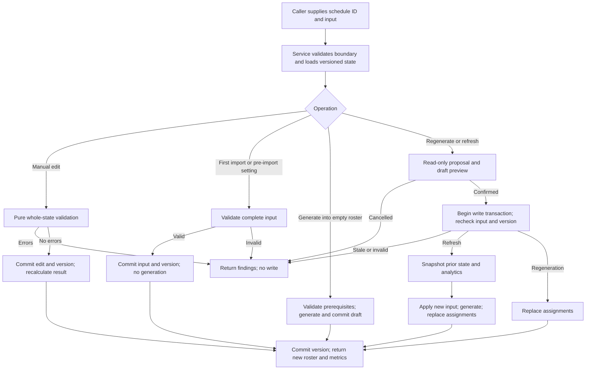

# Core scheduling logic — Stage 2 system design

**Task:** `core-scheduling-logic`  
**Basis:** [Approved Stage 1 specification](01-spec.md), especially FR-1–FR-10 and AC-01–AC-19.  
**Status:** Proposed design for review; no source code is implemented by this document.

## 1. Problem summary

The manager needs an independent, reusable Monday–Sunday schedule that turns one complete historical transaction report into hourly staffing requirements, supports staff and shift maintenance, produces an editable demand-aware draft, and reports coverage and workload accurately. A confirmed demand re-import or post-import threshold change must preserve the *prior* complete state and analytics, then replace the active roster with a new draft atomically. This manager-approved refresh rule supersedes the older retain-roster rule in the BRD.

The scope is the domain, model, SQLite, and service behavior in the approved spec. NiceGUI screens, authentication, publication, forecasting, payroll, breaks, availability, skills, overnight shifts, and dated rosters remain outside it. The repository currently persists only named schedules; the generic `shift_hours` helper accepts any valid same-day hours and must keep that contract. The design uses Python 3.10+, the standard library, the existing dependencies, and local SQLite. All externally accepted or returned integers and resulting integer totals are capped at `2^31 − 1`.

## 2. Proposed solution

1. **Load a complete schedule state.** A service reads one schedule by stable ID with its settings, staff, shift definitions, optional 112-cell demand, import warnings, assignments, and version. It rejects missing or cross-schedule references. A new schedule gets the two default shifts, threshold `20`, daily limit `1`, and empty staff, demand, and roster in one transaction.
2. **Validate at the boundary and in pure domain rules.** Parse uploaded CSV bytes with the spec's size and shape caps. Normalize English weekday headers and whole-hour labels into `(day 0–6, hour 7–22)`; require each of the 112 cells exactly once. Collect all discoverable positioned errors and warnings. Ignore only recognized title, total, and empty material. Strict integer checks reject booleans, fractions, non-finite values, negative counts, and values above the ceiling. An error or resource-limit breach produces no write. An empty demand table means *unavailable*; 112 stored zeros mean valid imported demand.
3. **Estimate demand and validate resulting state.** For each cell, `required = max(1, (transactions + N − 1) // N)` using Python's unbounded intermediate integers. Check weekly and returned totals against the ceiling before writing. One shared pure validator evaluates the proposed whole state: IDs and weekdays, shift ranges and duplicate definitions, duplicate assignments, and same-person overlap are errors; weekly maximum and daily shift limit are warnings for manual or definition/settings edits and hard eligibility limits for generation. Adjacent shifts are nonoverlapping but count separately toward the daily limit. The service commits an edit exactly when no error exists, then returns recalculated warnings and metrics. A reassignment evaluates removal and addition together.
4. **Generate a deterministic best-effort draft.** Require complete demand, at least one shift, and at least one employee eligible for some shift under weekly and daily limits. Start from an empty draft. For each feasible `(employee, day, shift)`, count shortage staff-hours removed and excess staff-hours added over every hour of that shift; score `3 × removed − added`. Choose the highest *positive* score, then lowest added excess, lowest current utilization, Monday–Sunday day order, shift start/end, shift ID, and employee ID. Compare utilization as exact fractions to avoid floating-point tie drift. Add the assignment and repeat until no positive candidate remains. Never invent shifts, use an ineligible employee, or add a shift solely for fairness. A capacity shortage after prerequisites yields a valid partial draft. An optional coverage-preserving fairness swap is deferred; the required tie rule already gives utilization a role.
5. **Calculate one coherent result.** Count scheduled people in each covered bucket. `covered = min(required, scheduled)`, `unmet = max(0, required − scheduled)`, and `excess = max(0, scheduled − required)`. Return hourly diagnostics, weekly sums and coverage, each employee's assigned/max hours and utilization, overall transactions per scheduled staff-hour, and the separate unweighted mean of staffed-cell transaction ratios. Ratios with zero denominators are undefined, never zero or infinity. Without demand, transaction and coverage results are unavailable. The same calculator supplies active reads, mutation responses, previews, and stored historical analytics.
6. **Preview before replacement.** First import and pre-import threshold edits commit directly without a snapshot or generation. A later valid re-import or threshold change gets a read-only preview containing the proposed normalized input, current schedule version, replacement draft/metrics, and impact on current assignments. Standalone regeneration of a nonempty roster likewise presents replacement impact before confirmation; generation into an empty roster may commit directly. Cancellation performs no write. At confirmation, the service revalidates the proposed input and checks the previewed version *inside* the write transaction. For a refresh it captures the old full state and old analytics, applies demand and/or threshold, generates from the new input, and replaces all assignments in that same transaction. A standalone regeneration changes assignments only and creates no history. A stale preview or any failure rolls the whole action back.

## 3. Domain model and database schema

**Domain records:** `ScheduleState` holds settings and the full set of `Employee`, `ShiftDefinition`, `DemandCell`, and `Assignment` records. `Violation` has stable code, severity, message, and structured details; import findings also include source row/column and normalized day/hour where available. `ScheduleResult` holds the Monday–Sunday roster grouped by configured shift, warnings, hourly diagnostics, and weekly/employee aggregates. `RefreshPreview` carries the baseline version, proposed normalized input, draft, and impact. `HistoricalSnapshot` carries an immutable prior-state copy, timestamp, reason, and calculated analytics. These are typed values passed between layers, not database-aware domain objects.

Proposed SQLite schema, extending the existing `schedules(id, name)` table without replacing existing IDs or names:

| Table | Key fields and constraints | Relationship / access |
|---|---|---|
| `schedules` | `id` PK, `name` nonblank by service validation, `threshold` positive, `daily_shift_limit` positive, `version` nonnegative; numeric values checked against the application ceiling | Parent for one typical week; `version` increments once per committed state change |
| `employees` | `id` PK, `schedule_id` FK, trimmed nonblank `name` of at most 100 characters, `weekly_max_hours >= 0`; unique `(schedule_id, id)` | Duplicate names allowed; index `(schedule_id, id)` |
| `shift_definitions` | `id` PK, `schedule_id` FK, `start_hour`, `end_hour`, `CHECK(7 <= start_hour AND start_hour < end_hour AND end_hour <= 23)`, unique `(schedule_id, start_hour, end_hour)`, unique `(schedule_id, id)` | Distinct shifts may overlap; index `(schedule_id, start_hour, end_hour, id)` for ordered reads |
| `demand_cells` | PK `(schedule_id, day, hour)`, `day` 0–6, `hour` 7–22, `transactions >= 0` | Zero rows means unavailable; exactly 112 rows is enforced at the service transaction boundary |
| `demand_import_warnings` | `(schedule_id, sequence)` key; code, message, source row/column, optional day/hour | Replaced alongside demand; preserves accepted import findings for later reads |
| `assignments` | `id` PK, `schedule_id`, `employee_id`, `shift_id`, `day` 0–6; unique `(schedule_id, employee_id, day, shift_id)` | Composite FKs `(schedule_id, employee_id)` and `(schedule_id, shift_id)` enforce ownership; indexes `(schedule_id, day, shift_id)` and `(schedule_id, employee_id, day)` support roster and validation reads |
| `history_snapshots` | `id` PK, `schedule_id` FK, `captured_at_utc`, `reason`, `prior_version`, `payload` | Append-only canonical JSON of the validated prior state, accepted import warnings, hourly metrics, weekly metrics, and employee metrics; index `(schedule_id, id)` supports listing |

All child rows have a schedule FK; foreign keys stay enabled for every connection. Database checks and uniqueness backstop the service validator. Overlap and complete-demand checks require whole-state validation. Assigned staff or shift removal deletes dependent assignments explicitly in the same confirmed transaction; restrictive FKs prevent an accidental dangling delete. Snapshot records are inserted only by confirmed refresh, never updated or deleted by baseline services. Use safe JSON serialization of typed records and validate its structure on read; no unsafe deserialization. Current warnings and metrics are derived from active rows rather than stored as mutable aggregates. Existing databases receive additive schema changes and defaults, with default shift rows for pre-existing named schedules; migration runs transactionally and idempotently. Newly allocated SQLite IDs are checked against the application ceiling before commit.

## 4. Interactions, interfaces, and failure behavior

`src/domain/` owns CSV normalization, numeric/structural validation, required-staff arithmetic, whole-state validation, generation, and metric calculation. The existing generic `shift_hours` remains unchanged; scheduling-specific shift validation restricts hours to 07:00–23:00. `src/model/` defines typed records/results. `src/db/` owns schema migration and parameterized, schedule-scoped queries. `src/services/` owns use cases and transaction boundaries. The future UI displays service results and obtains explicit confirmation; it does not implement business rules.

Service operations cover schedule create/list/get/rename; staff, shift, and setting edits; CSV validation/import preview; assignment add/remove/reassign; draft preview/commit; refresh preview/confirm; and snapshot list/read. A prepared result is read-only. The preview includes an opaque, process-signed token binding its schedule ID, version, operation, and digest of the normalized proposal; signing uses only standard-library primitives and a random process key. Confirmation supplies that token, the proposal, and an explicit confirmation flag. The service verifies the binding, revalidates the proposal, and compares the version inside the write transaction. A changed schedule, changed proposal, expired process token after restart, or cross-schedule token requires a new preview. The token protects preview integrity; it is not user authentication.

Errors carry stable codes and useful field, ID, or CSV position details. Invalid imports return all discoverable findings; prerequisite errors identify missing demand, shifts, or eligible staff. Invalid edits, cancelled actions, stale confirmations, integer overflow, and storage failures leave the prior active state and history unchanged. On a committed manual over-limit edit, the result includes exact before/added/after hours, limit, and excess. A confirmed used-shift edit checks *all* affected assignments. A confirmed employee or shift deletion removes dependents in one transaction. Returned active metrics are calculated from the committed state; historical metrics remain attached to their snapshot.

## 5. System flow

## 6. Security, consistency, reliability, and scaling

- Treat CSV bytes, browser values, environment values, and later service responses as untrusted. Cap CSV at 1 MiB, 256 rows, 32 columns, and 4,096 characters per cell before costly parsing; reject malformed decoding and limit failures distinctly. Validate ID ownership, integer types/ranges, and text length before SQL. Parameterize queries. Any future file-path import resolves a canonical path and verifies it lies within the allowed base directory. Do not log uploaded data.
- Use an explicit SQLite write transaction (for example, `BEGIN IMMEDIATE`) for each multirow action. Compare the preview version while holding the write lock, then snapshot, replace, and increment the version once. This serializes local writers and prevents a preview from overwriting intervening edits. Roll back on exceptions. Reads use one consistent connection/transaction for state and metrics. SQLite foreign keys and uniqueness constraints are a second line of defense.
- Python integer intermediates detect overflow before storing or returning capped values. Check all derived integer totals, not just scalar inputs. A failed insert, generation prerequisite, or interrupted process cannot leave a partial demand set, snapshot, or roster. Snapshot timestamps use UTC; IDs and ordered queries, not wall-clock timing, resolve deterministic ties.
- For the local 112-cell problem, compute each `(day, shift)` marginal score once per iteration, then evaluate employee eligibility and utilization. This avoids repeating the same hourly score for every employee. Measure against the spec's targets: valid import/metrics within 1 second and 100 employees/32 shifts generation within 10 seconds; measure confirmed refresh separately. If benchmarks miss, improve score caching without changing the deterministic selection rule. History grows with confirmed refreshes and is retained locally without automatic deletion; a future retention policy would require a separate decision.

## 7. Alternatives considered and trade-offs

| Alternative | Trade-off | Decision |
|---|---|---|
| Peak or average headcount per shift | Simple, but peak staffing can create excess and average staffing can miss peaks. | Use whole-shift marginal gain with the specified stop rule. |
| Global optimizer | Could improve coverage under interacting constraints, but adds a dependency or a larger algorithm and makes results harder to explain. | Keep deterministic greedy generation; report remaining shortages honestly. |
| Preserve the roster on re-import or threshold change | Avoids replacement, but conflicts with the manager-approved refresh workflow. | Require preview/confirmation, snapshot the old state, then regenerate atomically. |
| Normalize every historical snapshot into many child tables | Strong relational querying, but complex writes and schema evolution for immutable historical data. | Store a validated, versioned JSON snapshot in SQLite; retain relational active state. |
| Persist derived active metrics and warnings | Faster reads, but risks stale values after edits. | Derive active values from current rows; persist only accepted import warnings and immutable historical analytics. |

## 8. Risks and assumptions

- The spec's five earlier business questions are resolved; this design treats its confirmed-refresh rule as authoritative even though the spec header still says “Proposed for manager review.”
- A snapshot captures the complete state immediately *before* a confirmed refresh, including manual assignments and the old computed analytics; it does not copy older snapshots. Restore and deletion are outside scope.
- The historical CSV is one representative week, not a forecast. Zero transactions still require one person per open hour. The fixed 3:1 score weights are policy constants; a different weight is exercised through a policy-level test, not a manager setting.
- Greedy generation can leave shortages even when raw weekly capacity exceeds modeled demand because shifts are indivisible and coverage may require excess. It does not claim a global optimum.
- The 10-second generation target is an unmeasured acceptance target. Employee/shift counts have no approved hard cap beyond the CSV and integer limits; pathological schedules may require later profiling or a separately approved limit.
- The manager confirmed a 100-character maximum for trimmed, nonblank employee names. Duplicate names remain valid because stable IDs identify employees.

## 9. Open questions for manager review

None for this design. The manager confirmed the employee-name limit and accepted local indefinite snapshot retention until a separate retention/deletion policy is defined.
