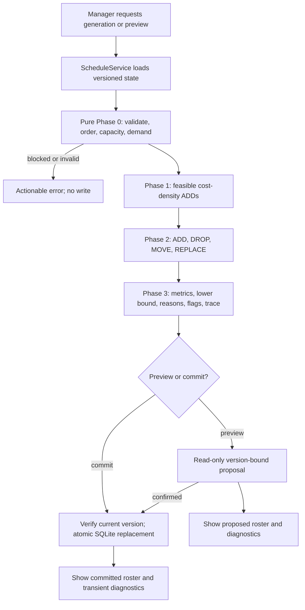

# Scheduling algorithm v2 — Stage 2 system design

**Task:** `scheduling-algorithm-v2`  
**Status:** Proposed for review; no source code changes in this stage.  
**Basis:** [Approved specification](01-spec.md), [algorithm appendix](../../resources/Staff_Scheduling_System_Alg_Upgrade.md), and the current domain, service, SQLite, and NiceGUI paths.

## 1. Problem summary

The current `src/domain/generation.py` makes one absolute-benefit greedy pass and returns only assignments. It cannot repair a poor early shift choice or an unfair allocation, and it cannot explain why demand remains unmet. The approved spec requires a pure, deterministic four-phase generator that produces a feasible best-effort roster, effective-capacity fairness, a conservative shortage lower bound, shortfall reasons, and an ordered decision trace. Required delivery covers Tiers A and B; global optimality is not promised.

Production remains a Monday–Sunday, 07:00–23:00 local NiceGUI application using Python 3.10+, existing SQLite schedules, and zero new runtime dependencies. Existing manual-edit warnings, CSV handling, BR-10 linear coverage/transaction metrics, version-bound preview and confirmation, and atomic refresh behavior remain in force. No schema migration, persisted generation diagnostics, solver, forecasting, rest rule, or Tier C analysis is included.

## 2. Proposed solution

**Phase 0 — prepare.** A typed pure entry point accepts normalized schedule data and configuration; the service adapts `ScheduleState` to it. Validate integer types and ranges, complete demand, unique valid references, shift windows, and configuration before search. Use prerequisite order `NO_DEMAND`, `NO_SHIFTS`, `NO_ELIGIBLE_STAFF`. Keep absent demand distinct from valid zero transactions; each open hour requires `max(1, ceil(transactions/N))` people. Defaults are `N=20`, `L=1`, `wUnder=3`, `wOver=1`, `wEmpty=6`, `maxPasses=50`, and `maxMoves=5000`; `N` and `L` come from schedule settings, while baseline weights are policy constants. Enforce `wUnder>wOver>=1` and `wEmpty>=wUnder`. Rest weighting stays zero for Tiers A/B. Start generation with no inherited assignments. Internal day count and operating bounds can vary for small tests; production values are fixed.

Canonical ordering is employee creation order then ID (today, SQLite `ORDER BY id` supplies this), day ascending, and shift `(start_hour,end_hour,id)`. Precompute each shift's duration and covered buckets and the shift overlap matrix. Maintain local staffing counts per hour, employee hours, assignment membership, and each employee's day shifts. All decision scans and trace entries use canonical order.

Compute effective capacity `cap_i` exactly: the greatest sum of configured shift durations no greater than the employee's maximum using at most `D×L` shifts. It intentionally ignores placement and overlap, so it is an upper bound, not a promise of assignable hours. To avoid a `maxHours`-sized array, let `q` be the largest distinct shift duration. In a minimum-shift representation, at most `q−1` copies of each smaller duration are needed: `q` copies of duration `a<q` can be replaced by `a` copies of duration `q`, preserving hours and reducing shift count. Set `B=(q−1)×sum(distinct durations below q)` and run a small unbounded minimum-coin DP for sums `0..B` using only those smaller durations. For any target `t`, its minimum shift count is the minimum of `dp[b]+(t−b)/q` over reachable `b≤t` with `b≡t (mod q)`. Search targets downward from `min(maxHours,D×L×q)` for at most `q` values; a multiple of `q` in that window is always feasible. This reproduces the spec recurrence exactly. In production `q≤16`, `B≤1800`, time is `O(B×number_of_distinct_durations + q×B)` and memory `O(B)`, independent of the employee maximum through `2^31−1`. Python integers hold intermediate products and optimizer costs; bounds on persisted inputs remain unchanged.

**Cost.** For required headcount `r≥1` and scheduled headcount `s`, a bucket costs `wEmpty` for its first missing person, `wUnder` for each further missing person, and `wOver` per excess person. Sum across buckets for primary cost `C`. The marginal cost of adding a person is `−wEmpty` at `s=0<r`, `−wUnder` at `0<s<r`, or `+wOver` at `s≥r`; removal is the inverse marginal. With total scheduled hours `H` and `Q=sum(cap_i)`, secondary integer cost is `F=sum_i |hours_i×Q−H×cap_i|` (`F=0` if `Q=0`). Compare `(C,F)` lexicographically; never worsen `C` to improve fairness. Divide only when formatting target hours, deviation hours, or utilization. Existing linear metrics are calculated separately and remain the manager-facing coverage figures.

**Phase 1 — construct.** Share H1–H5 predicates with `validate_state`: weekly maximum, daily shift limit, no same-person overlap, no duplicate triple, and valid references. Keep the public manual warning severities as they are; automatic assignment treats H1/H2 as hard limits. For each feasible `(employee,day,shift)`, calculate exact `ΔC`, `excessAdded`, and `ΔF`. Discard `ΔC≥0`; choose the smallest `ΔC/duration` by integer cross-products, then smaller excess, smaller `ΔF`, employee order/ID, day, and shift order. Add one winner and repeat to closure. Every accepted addition preserves H1–H5. A zero-capacity employee is ineligible. When capacity is insufficient but positive, return a valid partial roster.

**Phase 2 — refine.** Run passes in fixed order: ADD closure, DROP, MOVE, REPLACE. DROP scans a snapshot of assignments in canonical order and accepts only `ΔC<0`. MOVE removes one assignment tentatively, evaluates feasible destination slots on the resulting roster, chooses by `(ΔC,ΔF,day,shift order)`, and accepts only `ΔC<0` or `ΔC=0` with `ΔF<0`; otherwise restore the source. REPLACE scans slots and assignees in canonical order, tentatively removes an assignee, chooses the feasible replacement employee with smallest `(ΔF,employee order)`, and accepts only `ΔF<0`. Because the slot stays fixed, `ΔC=0`. Recheck H1–H5 on the resulting state before each acceptance. Count accepted refinement actions, including ADD closure; stop immediately at the move cap, after a pass with no change, or after the pass cap. A cap returns the current valid roster with `refinementCapped=true` and no local-optimality claim. Otherwise, no negative-`ΔC` ADD or negative-`ΔF` REPLACE remains. All accepted actions strictly reduce `(C,F)`.

**Phase 3 — diagnose.** Compute current BR-10 metrics through `calculate_result` and generation-only diagnostics from the final draft. Report per employee assigned hours, raw maximum, effective capacity, raw/effective utilization (`N/A` for zero denominators), proportional target, and deviation. Report `requiredHours`, `capacityHours=sum(cap_i)`, and `unavoidableUnmet=max(0,requiredHours−capacityHours)`, stating that **at least** that many of the actual unmet staff-hours cannot be avoided with current staff capacity. The remainder may reflect shift granularity, day constraints, or the stop rule.

For each configured day/shift slot containing an unmet hour, emit one slot record. Assign its reason in order: `NO_ELIGIBLE_STAFF` when no positive-capacity employee exists, `STOP_RULE` when adding to the slot has `ΔC≥0`, `CAPACITY` when nobody has weekly room for its duration, else `DAY_CONSTRAINTS` for daily limit, overlap, or existing assignment. Emit one separate `NO_SHIFT_COVERAGE` record for each unmet open hour outside every shift window. Overlapping slot records can describe the same shortage and must never be summed as distinct unmet hours. Compute informational `LOW_UTILIZATION` and `NEAR_ZERO_WHILE_OTHERS_FULL` flags per the spec, plus `REFINEMENT_CAPPED`; claim no coverage-neutral reassignment for the near-zero case only after checking that condition. Return final integer `C`, `F`, fairness deviation hours (`F/Q` when `Q>0`), zero rest violations, cap status, and a deterministic ordered trace of accepted ADD/DROP/MOVE/REPLACE actions with exact deltas and short explanations.

## 3. Domain model and database schema

Add immutable, typed domain outcome records for `blocked(reason,message)` or `ok(draft,diagnostics)`. Diagnostics contain optimizer costs, lower bound, employee reports, discriminated slot/hour shortfall records, flags, and trace steps. Use stable employee and shift IDs; temporary construction assignment IDs need only be deterministic and are replaced by SQLite IDs on commit. `ScheduleResult`/`Preview` can carry optional transient generation diagnostics so the UI sees the same draft and explanation. A plain `get_schedule` read produces no generation diagnostics.

**No schema change.** Existing `schedules(id,version,threshold,daily_shift_limit)`, `employees(id,schedule_id,weekly_max_hours)`, `shifts(id,schedule_id,start_hour,end_hour)`, `demand_cells(schedule_id,day,hour,transactions)`, and `assignments(id,schedule_id,employee_id,day,shift_id)` supply all inputs and persisted output. `history_snapshots` continues to capture prior state on confirmed refresh. Existing foreign keys, unique assignment triple, unique shift times, range checks, and schedule-scoped lookups remain the database backstop; H1/H2/overlap require domain checks. Current primary/unique indexes already support schedule loads and reference checks; `idx_history_schedule` supports history. No new index is needed for in-memory search, and diagnostics/trace are never written to SQLite.

## 4. Interactions, interfaces, and failure behavior

The pure generator takes normalized employees, shifts, complete hourly transactions, and config and returns a blocked or successful outcome without I/O or mutation. The service maps blocked codes to existing `SchedulingError` codes (`MISSING_DEMAND`, `MISSING_SHIFTS`, `NO_ELIGIBLE_EMPLOYEE`); malformed input or an explicit resource budget breach raises a structured error before writing. A shared hard-rule function drives `canAutoAssign` and whole-state validation; `validate_state` still reports manual weekly/daily excess as warnings.

`ScheduleService.generate` uses the new outcome for an empty roster. `preview_generation` and `preview_refresh` calculate draft and diagnostics without writing and bind the existing signed token to schedule version and proposal. `confirm_generation` and `confirm_refresh` verify the token and version inside `BEGIN IMMEDIATE`, rerun the deterministic generator against current state, and commit roster replacement with the version bump; refresh also snapshots prior analytics and updates demand or threshold in that same transaction. A stale or invalid token, cancelled confirmation, blocked prerequisite, or generation error leaves roster, demand, history, and version unchanged. Return diagnostics for the actual committed draft after confirmation, rather than relying on an uncommitted preview object.

The NiceGUI page shows lower-bound text, slot/hour reasons, costs and flags in the current generation summary; an optional explanation view can reveal the trace. When refinement is capped, label shortfall reasons as explanations of the **current draft**, without implying that local search was exhausted. The staff panel keeps `assigned / raw maximum` and adds effective capacity and target as secondary generation-only data. Store diagnostics only in the current page result or pending preview. Selection changes, reloads, manual edits, and stale confirmation clear them; normal linear metrics continue to describe the committed schedule.

## 5. Flow diagram

## 6. Security, consistency, reliability, and scaling

- Validate untrusted browser values, CSV data, config, and loaded rows at their boundaries. Reject booleans as integers, malformed or incomplete demand, invalid IDs, duplicate references, invalid shifts, and excessive work explicitly. Keep SQL parameterized and do not evaluate or deserialize input as code. Never log uploaded transaction data.
- Keep pure search state local to one call. Precompute shift coverage and overlap; update staffing counts and employee hours incrementally. Use Python integer arithmetic for optimizer values and exact cross-products, including values larger than the persisted 32-bit field range. Use a documented preflight candidate-work/trace budget to reject pathological inputs before writes. Set its threshold from the 100-employee/32-shift benchmark and verify API-maximum capacity cases; the budget must not narrow the accepted `2^31−1` weekly-maximum range.
- The existing schedule version and `BEGIN IMMEDIATE` lock prevent a stale preview from overwriting manual work. Preview and candidate evaluation never mutate SQLite. One transaction covers history, demand/threshold, assignments, and version on refresh; exceptions roll back the full action.
- Count-based pass/move caps bound refinement and preserve deterministic output. Construction also terminates because each addition is a previously absent feasible triple; bound its work and trace size by the finite candidate space. Do not use wall-clock stopping. A cap or partial roster is explained as a valid best-effort result, with the lower bound and exact unmet metrics.

## 7. Alternatives considered and trade-offs

| Approach | Benefit | Cost / decision |
|---|---|---|
| Keep the current absolute-benefit greedy pass | Smallest change | Misses peak-shift density, fairness repair, and required diagnostics; rejected by the spec. |
| Pure cost-density construction plus fixed local search | Explainable, deterministic, zero new dependencies, coverage-first fairness repair | May stop at a local optimum; **chosen** for Tiers A/B. |
| Exact solver or broader exchange search | Could improve or prove solution quality | New dependency or much larger search/complexity; outside scope. |
| `maxHours`-indexed capacity DP | Direct translation of appendix recurrence | Memory/time scale with `2^31−1` API maximum; use the bounded duration-residue method instead. |
| Persist trace and diagnostics | Survives reload | Risks stale explanations after manual edits and needs schema work; use transient output. |

## 8. Risks and assumptions

- The capacity method depends on whole-hour shift durations bounded by the 16-hour production window. Validate it against the appendix DP on tractable values and at the public maximum without allocating by `maxHours`.
- Employee ID order is treated as creation order because IDs are allocated monotonically and current reads use `ORDER BY id`. If import or migration later allows a different creation order, an explicit order field will be needed.
- A slot reason describes a configured shift window, while the existing hourly metric is the authoritative unmet staff-hour total. Slot records can overlap. On a capped draft, a `DAY_CONSTRAINTS` reason may describe current feasibility without claiming that every improving move was exhausted.
- Search performance and trace volume grow with employee and shift counts. The approved preflight work budget needs a measured, documented threshold and a clear rejection message; the 100-employee/32-shift target is a required benchmark.
- Effective capacity is a generous upper bound: its fairness target and shortage bound may understate practical day/overlap limits. Display it as an estimate of reachable hours under the relaxed duration model, not a guaranteed assignment.

## 9. Open questions for review

None. The owner approved a documented preflight candidate-work budget that preserves the weekly-maximum range and explicit current-draft labeling for shortfall reasons when refinement is capped. The numerical budget threshold is an implementation measurement, not an unresolved product decision. No source code has been changed in this stage.
