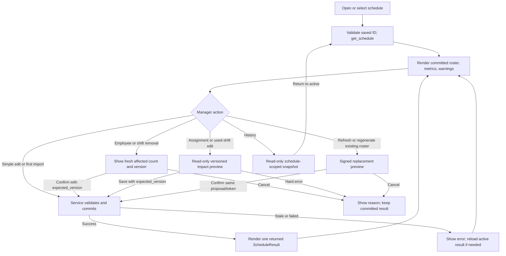

# Staff scheduling UI — Stage 2 system design

**Task:** `staff-scheduling-ui`  
**Basis:** [Approved Stage 1 specification](01-spec.md), the [approved core scheduling specification](../core-scheduling-logic/01-spec.md), and the current `ScheduleService` implementation.  
**Status:** Design for manager review; no source code is changed in this stage.

## 1. Problem summary

The manager needs one roster-first local browser page for creating and selecting a typical week, maintaining staff and shifts, importing demand, generating or manually editing a draft, and inspecting coverage, warnings, and prior states. The current `ui/app.py` is a landing scaffold; the backend already stores schedules and exposes most use cases. The missing backend capability is a read-only, version-bound preview of manual assignment choices and used-shift edits.

The UI must use stable record IDs and the service's rules and metrics, distinguish absent demand from an imported all-zero report, and require explicit review before replacing a nonempty roster or changing imported demand/threshold. Python 3.10+, NiceGUI 3.18.0, local SQLite, the existing `main.py` entry point, and no new dependencies are constraints. Publication, restore, authentication, forecasting, and new scheduling policy remain outside scope.

## 2. Proposed solution

Use one page controller per browser page with a selected schedule ID, the last committed `ScheduleResult`, an active or historical view mode, editor state, a pending proposal, a selection epoch, and a busy flag. Only the selected ID is remembered in browser-scoped storage. On entry, check that ID against `list_schedules`; otherwise choose the first schedule in creation order or show the create state. Load all active data with `get_schedule`. Creating or switching a schedule clears editors, proposals, and historical view, then reloads the selected schedule. Creation and rename use their existing service methods. Duplicate display names receive a visible ID suffix in pickers.

Render a compact header with schedule, demand, settings, draft status, summary values, and Auto-schedule. Below it, render the Monday–Sunday roster with one row per configured shift ordered by `(start, end, ID)`. Each cell shows its actual time and all assignees, including an explicit unassigned state, and opens an editor. Staff, shifts, import, hourly analysis, warnings, and history occupy accessible panels or tabs around this roster. A narrow viewport may scroll horizontally; keyboard focus returns near the action just completed. Re-render related views together from one returned service result after a successful write, without an optimistic saved state or page reload.

The UI presents validated input and service findings; it never calculates staffing demand, edit eligibility, violation severity, or generation outcomes. Staff and shift maintenance use existing service methods. Used staff/shift removal reads a fresh result and shows the affected assignment count with that result's schedule version. Confirmation passes the displayed version; if another tab changes the schedule, deletion is rejected and the manager must review a fresh count. A used-shift edit and each add/reassign choice use the new read-only service previews described below. Hard errors disable Save with the service reason. Weekly maximum and daily limit warnings remain selectable, with projected counts and exact overage shown before the write. Assignment removal uses its ID; reassignment uses one atomic `reassign_assignment` call.

For a first demand import, `validate_import` supplies a Monday-first 112-cell preview and all findings; `import_initial` stores valid demand without generating a roster. Before import, `set_threshold` updates the setting directly; after import, a threshold change uses `preview_refresh`, as does a re-import. The confirmation panel states that **all** assignments, including manual edits, will be replaced and the prior complete state saved to history. An empty-roster Auto-schedule calls `generate`; a nonempty roster calls `preview_generation` and requires `confirm_generation`. A valid partial draft is success with visible shortages. Standalone regeneration creates no snapshot. The read-only history panel uses `list_snapshots` and `get_snapshot`, presents the captured assignments as a historical roster without recomputing its analytics, and offers no edit or restore controls.

Hourly and weekly views format `ScheduleResult.hourly`, `.weekly`, `.employees`, and `.warnings` only. They show required versus scheduled, numeric shortage/excess, both separately labelled transaction ratios, `N/A` for zero-maximum utilization, and an en dash for undefined ratios or missing demand. Zero transactions remain visible as `0`; the open-hour minimum requirement is explained. Current warnings link to affected roster or analysis content where coordinates exist. Import warnings persist from the committed result; a new upload's findings stay in the proposal report until it is committed or closed.

## 3. Domain model and database schema

No new persistent UI table is needed. Browser storage contains only the last selected schedule ID; active results, editors, preview tokens, and uploaded CSV bytes are page/session state, never a second source of schedule truth. The existing SQLite schema remains authoritative:

| Table | Key fields, relationships, and constraints | Access |
|---|---|---|
| `schedules` | `id` PK, name, positive threshold and daily limit, nonnegative version | Creation-order list and optimistic version gate |
| `employees` | `id` PK, `schedule_id` FK, name, nonnegative weekly maximum; `(schedule_id, id)` unique | Schedule-scoped staff and assignment choices |
| `shifts` | `id` PK, `schedule_id` FK, valid whole-hour start/end, unique `(schedule_id, start_hour, end_hour)` | Schedule-scoped shift list, sorted by time in the result |
| `demand_cells` | PK `(schedule_id, day, hour)`; day 0–6, hour 7–22, nonnegative count | No rows means unavailable; a complete import has 112 cells |
| `assignments` | `id` PK, schedule/employee/shift FKs, day 0–6, unique `(schedule_id, employee_id, day, shift_id)` | Roster cells and affected-assignment counts |
| `demand_import_warnings` | PK `(schedule_id, sequence)`, structured warning payload | Accepted import findings on active reads |
| `history_snapshots` | `id` PK, `schedule_id` FK, UTC capture time, reason, prior version, immutable state/analytics payload | Read-only history; existing `(schedule_id, id)` index |

The existing composite ownership keys and foreign keys prevent cross-schedule assignments. Active results already contain typed `ScheduleState`, `RosterSlot`, `HourlyMetric`, `WeeklyMetric`, `EmployeeMetric`, and `Violation` records. Add typed preview results in `src/model/` for (a) a schedule/version and every employee option at a target cell and (b) a schedule/version and a proposed shift edit. Each option carries its employee ID, hard-blocked status, all findings, before/after hours and daily count, limits, and affected-hour/weekly coverage change when valid. The shift preview carries affected assignment IDs, people/days, old/new duration, all findings, and projected metrics when valid. A hard-error proposal need not calculate projected metrics. These are transient values; there is no migration or new index required for a 112-hour local week. Existing schedule-scoped reads and the history index suffice.

## 4. Important interactions, interfaces, and failure behavior

- **Manual preview:** `preview_assignment_options(schedule_id, day, shift_id, *, replacing_assignment_id=None)` loads one consistent state and evaluates all employees in one service read. A reassignment proposal replaces the identified assignment in memory as one operation. `preview_shift_edit(schedule_id, shift_id, start_hour, end_hour)` evaluates the changed definition and all affected assignments in memory. Both reuse existing boundary validation, `validate_state`, and `calculate_result`; neither writes nor increments the version. Invalid references/ranges become structured service errors or blocking findings for the UI to display.
- **Version-checked save and deletion:** Add optional `expected_version` to `add_assignment`, `reassign_assignment`, `edit_shift`, `remove_employee`, and `remove_shift`. Inside each method's write transaction, compare it with the loaded schedule version before any mutation or dependent-assignment deletion; mismatch raises `STALE_PREVIEW` and rolls back. Callers that omit it retain current behavior. The UI passes the version from an edit preview or the fresh result used to count assignments in a deletion confirmation. It uses the same proposal IDs and values on Save.
- **Replacement proposals:** Keep the exact CSV bytes or threshold together with the signed token, schedule ID, baseline version, and operation. Editing the proposal, closing it, switching schedules, or entering history discards it. Confirmation sends the same proposal and token; the service revalidates and checks the version under its write lock. A changed proposal, restart-invalid token, or stale version requires a fresh preview. Cancellation makes no service write.
- **Result and error boundary:** A successful mutation replaces the page's committed result as a unit. `SchedulingError` provides code, message, findings, and details for field or action-level feedback. Rejected validation and cancellation keep the last committed view. On `STALE_PREVIEW`, reload `get_schedule` and ask for a new preview; after uncertain storage/unexpected failure, show a recoverable error and reload before claiming a current state. A late asynchronous response is ignored if its captured schedule ID or selection epoch no longer matches the page. Disable repeat submissions while a call is in flight.
- **Deletion confirmation:** Cancel calls no removal method. Confirm sends `confirmed=True` and the exact version shown with the employee or shift's affected-assignment count. A stale rejection leaves the record and assignments intact, reloads the active result, and requires a new confirmation rather than silently retrying.

## 5. System flow

## 6. Security, consistency, reliability, and scaling

Treat browser fields, stored IDs, upload bytes, preview values, and tokens as untrusted. Accept upload bytes only, not a browser-supplied server path. Bound the upload while reading to 1 MiB, then let the service enforce its UTF-8, 256-row, 32-column, 4,096-character-cell, 112-cell, and integer limits. Use text/value UI APIs for names and findings; do not interpolate user content into HTML or log CSV/customer data. Keep the server bound to `127.0.0.1:8765`; preview tokens are integrity checks, not authentication.

The service's SQLite transactions and version checks are the final concurrency boundary. A preview never changes active state. A confirmed employee/shift deletion compares the displayed baseline version before removing the record and dependent assignments in one transaction. A confirmed refresh snapshots the prior state, updates demand or threshold, generates, replaces assignments, and increments version atomically. The UI captures schedule ID for each action and discards late responses for another selection. The last committed result remains visible through errors, but an uncertain read/write failure labels it as needing reload. Historical state is displayed in a separate read-only mode.

Render the seven-day roster as shift cells and load detailed hourly analysis on demand; avoid repeating the 112-cell analysis in the primary grid. Fetch employee options in one service read per opened cell. Keep busy feedback for generation and refresh, and run potentially slow service work without blocking interactive page updates. The core 1-second import/metrics and 10-second 100-employee/32-shift generation figures remain targets to measure, not assumed current performance.

## 7. Alternatives considered and trade-offs

| Approach | Trade-off | Decision |
|---|---|---|
| Put validation and coverage calculations in NiceGUI callbacks | May feel faster for simple forms, but duplicates policy and can disagree with committed service results. | Render service findings and metrics; UI validation is only input guidance. |
| Build separate day pages or a full 112-cell editable grid | Gives detailed per-hour visibility, but obscures the weekly roster or makes the main view dense. | One weekly shift grid with an on-demand hourly analysis panel. |
| Persist pending previews in SQLite or browser storage | Could survive restarts, but creates cleanup and stale-proposal risks; process-signed refresh tokens already expire on restart. | Keep proposals transient and require re-preview after interruption. |
| Save edits or confirm deletion without a version | Fewer checks, but a changed schedule could invalidate the reviewed impact or affected-assignment count. | Add read-only edit previews and optional transactional version checks for the three edit methods and two confirmed removal methods. |

## 8. Risks and assumptions

- The browser's selected ID is a convenience preference. Every page load verifies it against `list_schedules`; it grants no access by itself. Different browser sessions may choose different schedules.
- A draft is the current editable roster, including a partial one; there is no publish flag. An empty roster means no assignments even if demand exists.
- Delete confirmations use a fresh result and its version. A change before confirmation causes `STALE_PREVIEW`; the manager sees the new affected count and must confirm again. Existing callers may omit `expected_version` for backward compatibility, so they retain the prior behavior.
- A historical snapshot includes captured settings, demand, roster, warnings, and analytics. It has no restore/delete action. Snapshot retention remains indefinite under the approved core design.
- Responsive layout and keyboard focus need a manual visual/keyboard check in addition to interaction tests; no rendering behavior is claimed as implemented yet.

## 9. Open questions for manager review

None. The manager approved version checks for confirmed employee and shift removal; the decision is incorporated above.
